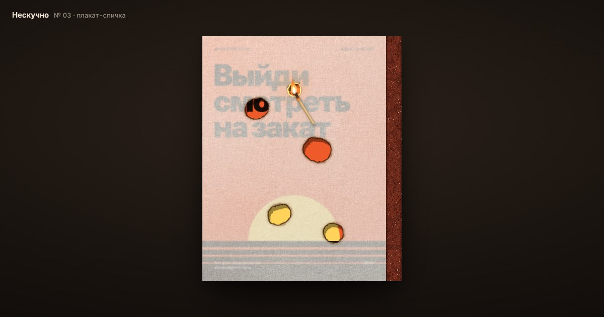

# Нескучно — плакат-спичка

Тактильный интерактивный плакат из серии «Нескучно». Плакат — это спичечный коробок: сверху лежит зернистая калька, сбоку — тёрка. Чиркни спичкой, дождись огня и прожги кальку — под ней по кусочкам проявляется идея, чем заняться вечером.

Тема серии — **digital tactility**: физические свойства материалов (зерно бумаги, трение тёрки, жар, пепел) перенесены в цифровую графику.



## Как это устроено

| Слой | Что делает |
|---|---|
| Плакат | Картинка из `assets/posters`. Сквозь кальку видна размытой, в дыре — чёткой |
| Калька | WebGL2-шейдер: полупрозрачность, зерно, волокна, неровная плотность |
| Рисунок на кальке | Необязательная картинка поверх кальки в режиме multiply, горит вместе с ней |
| Прожог | Клеточная симуляция (огонь, жар, обугливание, «волокна»), маска уходит в шейдер текстурой |
| Тёрка | Canvas 2D: зернистая полоса, на ней остаются следы каждого чирка |
| Спичка | Курсор, нарисованный на отдельном canvas поверх всего: древко, головка, пламя, обугливание |
| Частицы | Искры от чирка, пепел и редкие искорки с кромки, дым от погасшей спички |
| Звук | Синтезирован в WebAudio из шума — без аудиофайлов. Включается после первого клика |

**Механика**
- Медленно по тёрке — ничего (только след). Резко — искры. Со 2–3-й резкой попытки — вспышка.
- Пламя колышется и отклоняется от движения, спичка горит 8–12 секунд, обугливается и гаснет — нужен новый чирк.
- Коснулась кальки — прожог расползается сам ещё пару секунд, потом затухает. Держишь пламя на месте — жар захватывает больше. Быстрый мах — только подпалина.
- Кромка: тлеющий оранжевый фронт → тёмно-коричневый → чёрный обугленный край → дыра. Каждый прожог уникален (случайное зерно бумаги и случайное распространение).

**Управление**

| Клавиша | Действие |
|---|---|
| `S` | Сохранить текущее состояние в PNG (плакат + тёрка, 2400 px по высоте) |
| `R` | Новая калька |
| `N` | Следующий плакат |
| `M` | Звук вкл/выкл |
| `U` | Загрузить свой плакат |
| `K` | Загрузить рисунок на кальку |

То же — кнопками в интерфейсе. На телефоне спичка ведётся пальцем и рисуется чуть выше пальца, чтобы её было видно.

## Свои картинки

### Для посетителя: кнопка «Загрузить»
- **Свой плакат** ляжет под кальку вместо плаката серии. Он встаёт в общую карусель (`N` листает и его).
- **Рисунок на кальку** накладывается на кальку в режиме **multiply**: белое и прозрачное ничего не меняют, тёмное «печатается». Рисунок подпаливается и сгорает вместе с калькой, а в дыре виден чистый плакат. Сама калька (текстура, прозрачность) не меняется. Новый рисунок — новый лист, поэтому прожог сбрасывается.
- Файл можно просто перетащить в окно: появятся две зоны, «Плакат» и «Рисунок на кальку».
- Загрузки сохраняются в браузере (IndexedDB) и переживают перезагрузку, но на сервер не отправляются. Убрать их можно в том же меню.
- Лучше всего подходят PNG с прозрачностью или JPG на белом фоне. Рисунок заполняет кальку с обрезкой лишнего (`overlay.fit` в конфиге).

### Для автора серии
1. Положи плакаты в `assets/posters/` (JPG/PNG/WebP, лучше 3:4, от 1200×1600) и перечисли в `src/config.js` → `posters`. Сейчас там три заглушки.
2. Рисунок на кальку по умолчанию: положи файл в `assets/overlays/` и укажи `overlay.src` в `src/config.js`. Пример уже лежит: `assets/overlays/marks.png` (метки совмещения и штамп).
3. Параметры в адресе: `?p=2` — плакат №2, `?poster=путь.jpg` — любой плакат, `?overlay=assets/overlays/marks.png` — любой рисунок на кальку.

## Настройка ощущения

Все ручки — в `src/config.js`, с комментариями. Самые полезные:

- `paper.opacity`, `paper.blur` — насколько калька плотная и как сильно размывает плакат.
- `burn.contactRate`, `burn.igniteRate` — насколько легко прожигается.
- `burn.spreadKeep`, `burn.fireDecay` — как далеко и долго огонь ползёт сам.
- `match.minLife`/`maxLife`, `strikesMin`/`strikesMax` — сколько горит спичка и с какой попытки зажигается.
- `strike.fastSpeed` — насколько резким должен быть чирк.
- `flame.lean` — `-1`: пламя отстаёт от движения (как в жизни), `1`: клонится в сторону движения.

## Запуск локально

Проект без сборки и зависимостей, но из-за ES-модулей его нужно открывать через локальный сервер, а не двойным кликом по `index.html`:

```bash
npx serve .
# или
python3 -m http.server 8000
```

## Деплой

Все пути относительные, так что сайт работает и в корне домена, и в подпапке (`username.github.io/neskuchno/`).

### GitHub Pages
1. Создай репозиторий и залей в него содержимое этой папки (файл `.nojekyll` тоже нужен).
2. **Settings → Pages → Build and deployment → Source: Deploy from a branch**, ветка `main`, папка `/ (root)`.
3. Через минуту сайт будет на `https://<username>.github.io/<repo>/`.

### Netlify
- Быстро: перетащи папку на [app.netlify.com/drop](https://app.netlify.com/drop).
- Или подключи GitHub-репозиторий: настройки сборки подхватятся из `netlify.toml` (сборки нет, публикуется корень).

### Превью для соцсетей
`og.jpg` подключён в `index.html`. Некоторые соцсети требуют абсолютный адрес — после деплоя замени `content="og.jpg"` на полный URL, например `https://<username>.github.io/<repo>/og.jpg`.

## Совместимость

Нужен WebGL2: актуальные Chrome, Edge, Firefox, Safari 15+ (macOS и iOS), Android Chrome. Если WebGL2 нет, страница вежливо об этом скажет.

## Структура

```
index.html          разметка и UI
styles.css          оформление
src/config.js       все настройки и список плакатов
src/main.js         раскладка, ввод, чирк, загрузки, цикл, экспорт PNG
src/renderer.js     WebGL2 и шейдер кальки/прожога
src/burnsim.js      симуляция огня
src/striker.js      тёрка и следы
src/match.js        спичка и пламя
src/particles.js    искры, пепел, дым
src/audio.js        звук
src/store.js        память загрузок в браузере (IndexedDB)
assets/posters/     плакаты-идеи
assets/overlays/    рисунки на кальку
```
